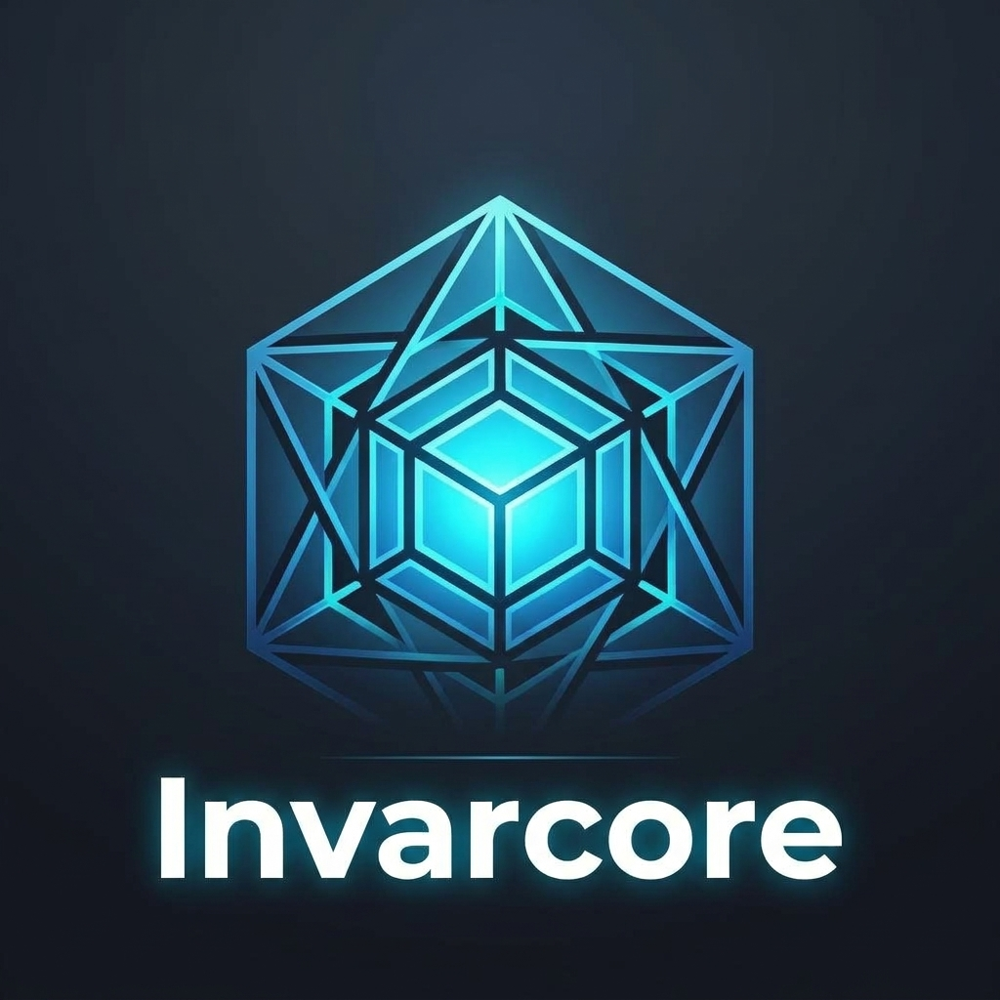

<div align="center">



# Invarcore
### Deterministic Invariants & Verifiable Infrastructure for Autonomous Systems

[](https://github.com/invarcore)
[](https://github.com/invarcore)
[](https://github.com/invarcore)
[](https://github.com/invarcore)

<p align="center">
  <b>Invarcore</b> builds zero-trust runtime infrastructure, formal verification gates, and deterministic execution tools for autonomous AI agents, LLM applications, and enterprise knowledge pipelines.
</p>

</div>

---

### The Invarcore Verification Fabric

Autonomous agents and RAG pipelines are stochastic and prone to silent drift, infinite loops, and sensitive data leakage. The Invarcore ecosystem enforces **system invariants** across every stage of the execution lifecycle:

```
                      ┌──────────────────────────────────────┐
                      │    Enterprise Knowledge Sources      │
                      │   (Jira, Confluence, Notion, SQL)    │
                      └──────────────────┬───────────────────┘
                                         │ Ingest & Scrub (DLP)
                                         ▼
   ┌────────────────────────────────────────────────────────────────────────┐
   │ 📚 knowledge-fabric-enterprise-adapters                                │
   │ Fail-closed SaaS adapters with Zero-Leak regex token sanitization      │
   └─────────────────────────────────────┬──────────────────────────────────┘
                                         │ Clean Document Streams
                                         ▼
   ┌────────────────────────────────────────────────────────────────────────┐
   │ 🧠 knowledge-fabric                                                    │
   │ Hybrid RRF evidence engine (Vector + BM25) with signed EvidencePackages│
   └──────────────────┬──────────────────────────────────┬──────────────────┘
                      │                                  │
                      ▼ Watermark Evidence Chunks        ▼ Grounding Context
   ┌─────────────────────────────────────┐  ┌───────────────────────────────┐
   │ 🛡️ canary-fabric                    │  │ ⚡ cachealign                 │
   │ Invisible steganographic tripwires  │  │ Autonomous prompt cache       │
   │ & sub-ms data-leak circuit breakers │  │ optimizer & prefix alignment  │
   └──────────────────┬──────────────────┘  └──────────────┬────────────────┘
                      │                                    │
                      ▼ Guarded Execution Envelopes        │ Optimized Payloads
   ┌───────────────────────────────────────────────────────┴────────────────┐
   │ ⚖️ intent-fabric                                                       │
   │ Policy-governed autonomous agent planner & HMAC action sign-off gates  │
   └─────────────────────────────────────┬──────────────────────────────────┘
                                         │ Supervised Execution
                                         ▼
   ┌────────────────────────────────────────────────────────────────────────┐
   │ ⏪ unloop                                                              │
   │ Time-travel agent debugger, cognitive turn rewind & anti-oscillation   │
   └────────────────────────────────────────────────────────────────────────┘
```

---

### Core Engine Directory

| Engine | Description | Invariant Enforced | Tech Stack |
| :--- | :--- | :--- | :--- |
| **[`canary-fabric`](https://github.com/invarcore/canary-fabric)** | Invisible cryptographic tripwires & sub-millisecond data-leak circuit breakers. | *Zero unmonitored data exfiltration in RAG pipelines.* | Python, FastMCP, Steganography, HMAC |
| **[`intent-fabric`](https://github.com/invarcore/intent-fabric)** | Policy-governed autonomous agent planning with cryptographic approval contracts. | *No state-mutating action executes without verified intent.* | Python, Pydantic, Ed25519, OpenRouter |
| **[`knowledge-fabric`](https://github.com/invarcore/knowledge-fabric)** | MCP-native hybrid evidence retrieval (pgvector + BM25 Reciprocal Rank Fusion). | *All agent generation must be grounded in digested evidence.* | Python, pgvector, PostgreSQL, MCP |
| **[`enterprise-adapters`](https://github.com/invarcore/knowledge-fabric-enterprise-adapters)** | Fail-closed SaaS document ingestion with automated PII and DLP secret scrubbing. | *Enterprise credentials and PII never touch vector stores.* | Python, Confluence/Jira/Notion APIs |
| **[`unloop`](https://github.com/invarcore/unloop)** | Time-travel debugger for AI agents — cognitive rewind & anti-oscillation watchdog. | *Agent reasoning loops must terminate deterministically.* | Python, SQLite WAL, Terminal UI |
| **[`cachealign`](https://github.com/invarcore/cachealign)** | Autonomous prompt cache optimizer & prefix alignment middleware for LLM agents. | *Prompt prefixes remain stable across turns for max cache hits.* | Python, Proxy Middleware, Redis/Memory |

---

### Engineering & Reliability Standards

All Invarcore engines adhere to strict production criteria:
1. **Two-Tier Test Isolation**: 100% offline, deterministic unit test fixtures in CI (`tests/fixtures/corpora/`), with opt-in live network integration harnesses. CI builds never fail due to upstream DNS timeouts or rate limits.
2. **Fail-Closed Execution**: If any canary tripwire, approval signature, or policy gate fails or times out, the system fails closed rather than executing unsafe operations.
3. **Cryptographic Non-Repudiation**: Evidence packages, execution envelopes, and approval contracts carry verifiable HMAC-SHA256 signatures.
4. **Strict Code Coverage**: All repositories enforce $\ge 90\%$ test coverage in automated CI pipelines.

---

### Security & Vulnerability Reporting

Security is a primary design goal across all Invarcore software. If you identify a security vulnerability, please refer to our [Security Policy](https://github.com/invarcore/.github/blob/main/SECURITY.md) to report it privately.

<div align="center">
  <sub>© 2026 Invarcore · Open Source under Apache-2.0 & MIT Licenses</sub>
</div>
